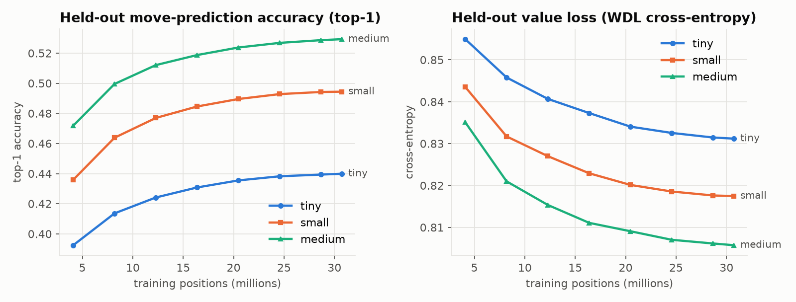
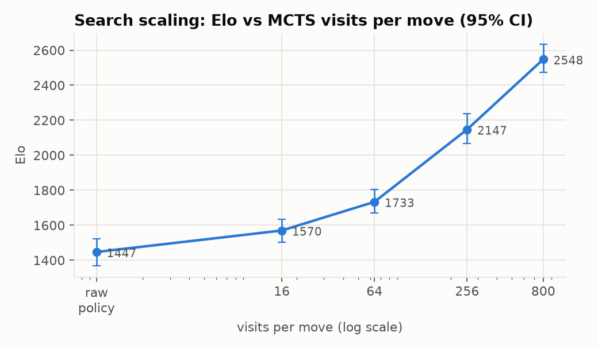
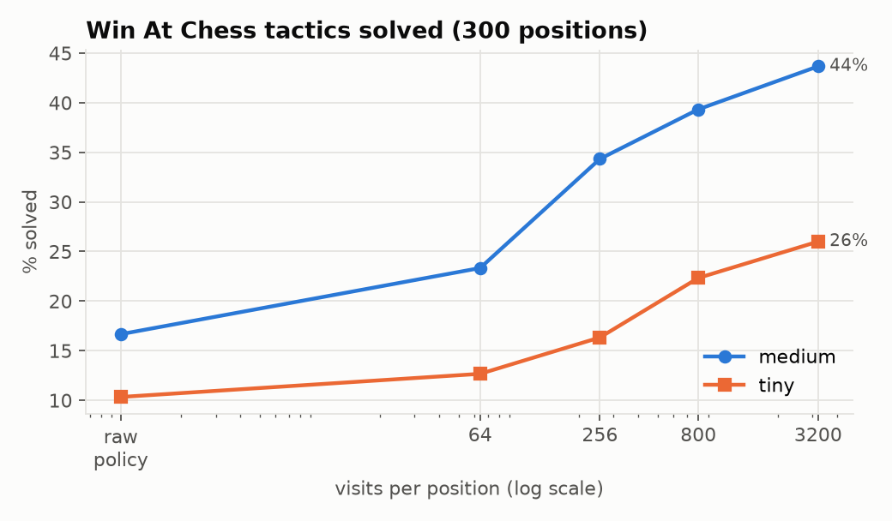
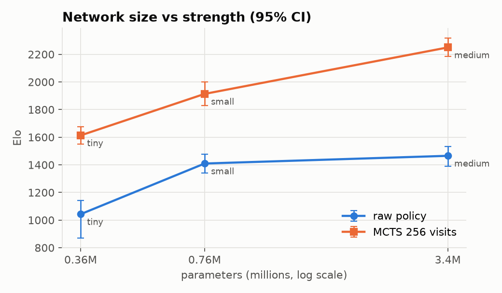
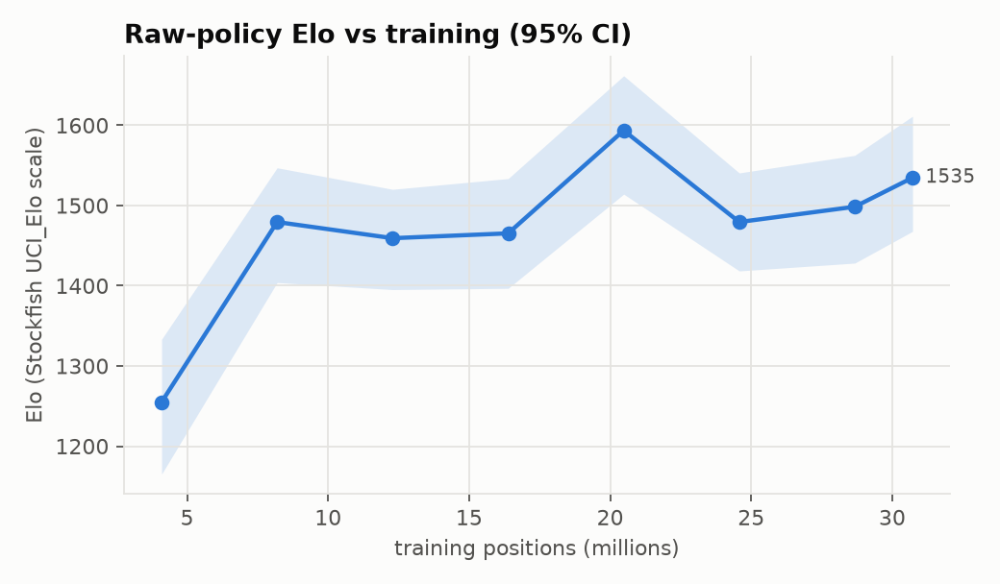
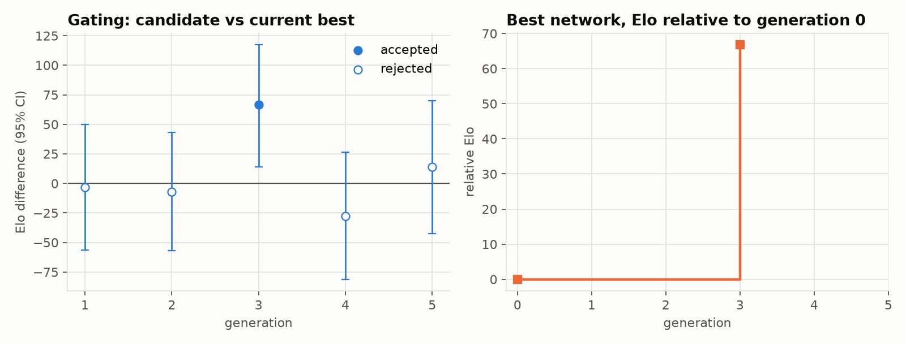

# neural-mcts-chess: an AlphaZero-style chess engine on a student budget

A residual CNN policy/value network plus batched Monte-Carlo tree search,
pretrained on 540k high-rated Lichess games, refined by self-play with gating,
measured in Elo against calibrated Stockfish, and deployable as a Lichess bot.
Everything, from data to the final ablations, ran on one laptop GPU (Apple M5,
16 GB, PyTorch MPS) in about a day of wall-clock time.

| | Result |
|---|---|
| Held-out human-move prediction (10×128 net) | **52.7% top-1, 90.2% top-5** on 399k positions from unseen games |
| Strength, raw policy (no search) | **1447** Elo [1367, 1521] |
| Strength, MCTS 800 visits/move | **2548** Elo [2473, 2633], scored 50% against Stockfish at UCI_Elo 2600 |
| Search scaling | raw policy → 800 visits: **+1100 Elo**; Win At Chess tactics solved 17% → 44% |
| Self-play refinement | 8 generations, 9.6k games in 95 min; best network **+20 Elo [−9, +49]** over pretraining in a 300-game re-test |
| Throughput | 12.2k MCTS visits/s batched across games (92% of raw GPU throughput); C++ move generator 100M perft nodes/s (43× python-chess) |

Elo is on Stockfish 19's `UCI_Elo` scale. Stockfish played at 0.2 s/move,
and our engine at a fixed number of visits per move. Intervals are 95%
bootstrap CIs over games. See [Limitations and caveats](#limitations-and-caveats).

## Highlights

- **C++17 core with pybind11 bindings.** A bitboard move generator and an
  arena-allocated batched PUCT search. The move generator passes perft on six
  standard positions and matches python-chess on more than 5,000 random-game
  positions. The search produces **visit counts identical** to a readable
  pure-Python reference implementation, with and without virtual-loss batching.
- **Batched GPU inference across hundreds of concurrent games.** Virtual loss,
  collision handling, an NN-evaluation cache shared across games, tree reuse,
  power-of-two batch padding, legal-move logit gathering on the device, and a
  double-buffered pipeline that overlaps CPU tree search with GPU inference.
  Tree work takes under 10% of search time, so search is GPU-bound.
- **Data pipeline.** Resumable HTTP-range download of a 33 GB Lichess dump
  prefix, then a header filter (145k games/s), then parallel SAN → tensor
  encoding in C++ (~1M positions/s; 540k games → 39M positions in 33 s).
  Positions are stored as a **100-byte bit-packed record** (56× smaller than
  float planes) and expanded to planes **on the GPU**.
- **Training.** fp16 autocast with loss scaling (bf16 on CUDA), EMA weights,
  legal-move-masked policy loss, a WDL value head, cosine LR with warmup,
  decoupled weight decay that skips norms and biases, full-state
  checkpoint/resume, TensorBoard, JSONL and optional W&B logging, and a
  train/val/test split by game.
- **Self-play RL loop** (AlphaGo Zero style). Dirichlet root noise, a
  temperature schedule, KataGo playout-cap randomization, resignation with a
  no-resign control group (2.1% false positives measured), a replay window
  mixed with human data, z+q value targets, and gating with an Elo CI and SPRT.
  The loop resumes from any phase.
- **Evaluation.** A concurrent match runner in which Stockfish thinks in
  background threads while all of our games share one GPU batch. Paired
  openings from a 50-line book, an adaptive Stockfish ladder (probe, then
  bracket), an MLE rating with Fisher-information and bootstrap CIs, Wilson-style
  per-opponent intervals, and a Win At Chess (WAC) tactics benchmark.
- **UCI engine and Lichess bot.** Threaded search with `stop`, time management
  with Lc0-style smart pruning, tree reuse across `position` commands,
  centipawn and WDL reporting, and a lichess-bot config, engine wrapper,
  setup script and Dockerfile (see [deploy/](deploy/README.md)).
- **106 tests** (11 s), run in CI on Linux and macOS. They cover perft,
  C++/python-chess equivalence, move-index bijection and mirror symmetry,
  encoding round-trips on CPU and GPU, MCTS invariants, Elo statistics, the
  data pipeline, overfitting a batch, checkpoint resume, and end-to-end UCI,
  match and self-play runs.

## Architecture

```
 Lichess dump (.pgn.zst, 33 GB) ──range download──▶ prefix (3 GB, 9.8M games)
        │ header filter: both ≥2000, ≥3+0, normal termination   (145k games/s)
        ▼
 540k games ──multiprocess──▶ C++ encode_game (SAN parse + legal moves + encode)
        ▼
 shards/*.npz: bb[12]×u64 · meta[4]×u8 · move · legal moves · result · ply · elo
        │                                    (split by game hash: train/val/test)
        ▼
 IterableDataset → whole-batch vectorised gather → GPU: bits → 22×8×8 planes
        ▼
 ┌────────────── ResNet (B blocks × F filters, optional SE) ──────────────┐
 │ policy head: conv → 73×8×8 = 4672 logits   value head: conv → FC → W/D/L │
 └─────────────────────────────────────────────────────────────────────────┘
        │ supervised: CE(masked policy, human move) + 0.5·CE(WDL, result)
        ▼
 Batched MCTS (C++) ◀──── evaluator (one GPU call per batch of leaves) ────┐
   gather leaves from N trees (virtual loss) ──▶ NN ──▶ expand + backup ───┘
        │
        ├──▶ self-play (noise, PCR, resign) ──▶ replay buffer ──▶ retrain ──▶ gate vs best
        ├──▶ match runner vs Stockfish ladder ──▶ MLE Elo ± CI, ablations, charts
        └──▶ UCI engine ──▶ lichess-bot ──▶ lichess.org
```

### Encodings

**Moves.** AlphaZero's 8×8×73 scheme: 56 queen-move planes (8 directions × 7
distances), 8 knight planes and 9 under-promotion planes. Index = `plane·64 +
from_square`, which matches a convolutional policy head flattened in
plane-major order. Squares are oriented to the side to move, with the board
mirrored vertically for black, so the network always plays "up the board".
1,858 of the 4,672 slots are geometrically reachable, the same count Lc0 uses.

**Board.** 22 planes: our/their P N B R Q K (12), two repetition planes, an
en-passant square (only when the capture is legal), four castling planes, a
side-to-move colour plane, a halfmove clock / 100 plane, and a constant plane
that marks the board edge for zero-padded convolutions. The compact form
(12 bitboards + 4 bytes) is what is stored, batched and sent to the GPU. A
position and its colour-flipped mirror encode identically apart from the
colour plane, and a test checks this.

**Game rules** (identical in both backends, checked in this order):
checkmate/stalemate, insufficient material (a port of python-chess's rules),
the fifty-move rule and threefold repetition, both applied automatically.
Inside the search tree, a repetition of a position reached *after* the root
scores as a draw (the Stockfish/Lc0 two-fold rule).

### Network

Post-activation ResNet: 3×3 stem, then `B` residual blocks (conv-BN-ReLU-
conv-BN, optional squeeze-and-excitation with per-channel scale *and* bias as
in Lc0, then skip and ReLU). The last BN of each block is zero-initialised so
blocks start as the identity. The policy head is conv 3×3 → conv 1×1 to 73
planes. The value head is conv 1×1 (32) → FC 128 → 3 W/D/L logits (or
tanh-scalar). Three sizes were trained on identical data: 4×32 (0.36M
parameters), 6×64 (0.76M) and 10×128 (3.4M). SE is off locally because the
SE pooling ops halve throughput on Apple's MPS backend. It is on in
`configs/sl_large_cuda.yaml`.

### Search

PUCT with AlphaZero's growing exploration constant
`c(N) = c_init + log((N + c_base + 1)/c_base)`, Lc0-style first-play urgency
(`Q_parent − r·√(visited policy)`), virtual loss for in-flight leaves, and
collision detection. Children are stored contiguously in a flat arena. When
the tree is reused between moves, the chosen subtree is copied breadth-first
into a fresh arena. The NN cache key includes the halfmove clock and
repetition count, because the network sees them.

`gather_batch` walks every game's tree and returns encoded leaves plus flat
legal-move indices. The evaluator runs one forward pass, gathers only the
legal logits on the device and returns ~35 floats per position.
`apply_batch` expands and backs up the results. Both release the GIL.

## Results

All numbers below were produced by the code in this repository; the raw JSON
is in `results/` and the figures are regenerated with `make plots report`.

### Supervised pretraining: held-out move prediction



Each network trained for 30k steps × 1024 positions (~0.8 epochs of 38.5M
positions). Accuracy is measured on the **test split**: 399k positions from
games never seen in training or validation, legal moves only.

| Network | Params | Top-1 | Top-5 | Policy CE | Value MSE |
|---|---:|---:|---:|---:|---:|
| 4×32 | 0.36M | 43.9% | 82.3% | 1.813 | 0.743 |
| 6×64 | 0.76M | 49.2% | 87.7% | 1.580 | 0.728 |
| 10×128 | 3.40M | **52.7%** | **90.2%** | 1.441 | 0.714 |

For reference, Maia's human-move-prediction networks report roughly 50–53% top-1.
The 10×128 network predicts the move best in the opening (54.4% for plies 0–20)
and in simplified endgames (55.0% after ply 80). It is worst in the
middlegame (51.0%) and on the rare 2600+ games (46.9%, 1.7% of the data).

### Elo vs Stockfish

Each configuration plays a 12-game probe, then 32 games against each of three
Stockfish levels 200 Elo apart, bracketing the probe's estimate. That is 108+
games per configuration, colour-reversed pairs over 50 book openings, and
2,304 games against Stockfish in total, plus 1,100 engine-vs-engine games for
gating and the head-to-head. The rating is the joint maximum-likelihood
estimate over all of a configuration's games.

#### Raw policy vs MCTS (search scaling, 10×128 network)



| Search | Elo [95% CI] | Games (W/D/L) | Score by Stockfish level |
|---|---|---|---|
| raw policy (no search) | **1447** [1367, 1521] | +37 =10 −61 | 1320: 0.66, 1520: 0.36, 1720: 0.22 |
| MCTS, 16 visits/move | **1570** [1501, 1635] | +55 =5 −48 | 1320: 0.89, 1520: 0.62, 1720: 0.22 |
| MCTS, 64 visits/move | **1733** [1669, 1803] | +70 =9 −29 | 1350: 0.94, 1550: 0.77, 1750: 0.52 |
| MCTS, 256 visits/move | **2147** [2069, 2237] | +81 =8 −19 | 1700: 0.83, 1900: 0.80, 2100: 0.75 |
| MCTS, 800 visits/move | **2548** [2473, 2633] | +81 =13 −26 | 2200: 0.89, 2400: 0.66, 2600: 0.50 |

Search is worth about 1100 Elo between the raw policy and 800 visits, and the
curve is still steep at 800 visits. Without search, the policy misses many
tactics, as the tactics benchmark shows directly:



| Network | raw policy | 64 visits | 256 visits | 800 visits | 3200 visits |
|---|---:|---:|---:|---:|---:|
| 10×128 | 50/300 | 70/300 | 103/300 | 118/300 | 131/300 |
| 4×32 | 31/300 | 38/300 | 49/300 | 67/300 | 78/300 |

#### Network size vs strength



| Network | Params | Raw policy Elo | MCTS-256 Elo |
|---|---:|---|---|
| 4×32 | 0.36M | **1043** [871, 1141] | **1613** [1551, 1675] |
| 6×64 | 0.76M | **1409** [1341, 1476] | **1914** [1828, 2002] |
| 10×128 | 3.40M | **1465** [1390, 1532] | **2250** [2185, 2318] |

Bigger networks gain more from search: 10×128 vs 6×64 is +56 Elo without
search but +336 with 256 visits. This is consistent with a better value head
paying off across many evaluations inside the tree, while raw-policy strength
saturates sooner. (The 10×128 MCTS-256 point was
measured three times in independent ladders, at 2147, 2250 and 2157. That ~100
Elo spread is the honest noise floor of a 108-game ladder.)

#### Elo vs training step (10×128, raw policy)



Raw-policy strength rises from 1255 to ~1500 within the first 8M positions and
then stays within its CIs, even though held-out accuracy keeps improving
(47.2% → 52.9%). This suggests the extra accuracy mostly buys more human-like
moves rather than fewer tactical blunders. At this scale, search buys far more
Elo than more supervised data.

### Pretraining-only vs self-play-refined



Eight generations of 1,200 self-play games each (25% full 200-visit searches
recorded as training samples, the rest 32-visit fast moves), 400 training
steps per generation on a 3-generation replay window mixed 70/30 with human
games, and 100-game gating at 160 visits against the current best. Total cost:
9,600 games, ~200k recorded positions, 95 minutes.

| Gen | Gating score vs current best | Elo diff [95% CI] | Accepted |
|---:|---:|---|---|
| 1 | 0.495 | −3 [−57, +50] | no |
| 2 | 0.490 | −7 [−57, +43] | no |
| 3 | 0.595 | **+67 [+14, +117]** | **yes** |
| 4 | 0.460 | −28 [−81, +26] | no |
| 5 | 0.520 | +14 [−42, +70] | no |
| 6 | 0.525 | +17 [−36, +70] | no |
| 7 | 0.475 | −17 [−73, +39] | no |
| 8 | 0.485 | −10 [−63, +42] | no |

Gating selects the candidate that *happened* to score well, so its +67 is
biased upward (a winner's curse). The independent re-test is 300 fresh games
between the generation-3 network and the pretrained network at 256 visits:

| Comparison | Result |
|---|---|
| Head-to-head, self-play gen 3 vs pretrained (300 games) | +90 =137 −73, score 0.528, **+20 Elo [−9, +49]** |
| Pretrained vs Stockfish ladder (MCTS 256) | 2157 [2075, 2241] |
| Self-play gen 3 vs Stockfish ladder (MCTS 256) | 2292 [2218, 2364] |

**Verdict:** self-play refinement helps a little: the head-to-head and the
Stockfish ladders both point the same way. With 9.6k games, though, the gain
is not significant at 95%. That is the expected outcome at this budget:
AlphaZero used ~44M games, and a supervised network trained on 39M strong
human positions is a hard baseline to move with 200k self-play positions. The
infrastructure scales (9.6k games/hour). The next lever is more games per
generation, not more code.

### Throughput (Apple M5, 10×128 network, idle machine)

| Component | Measurement |
|---|---|
| Move generation (perft, bulk counting) | 99.7M nodes/s C++ vs 2.3M python-chess (**43×**) |
| Search node ops (legal moves + encode + push), incl. Python call overhead | 547k/s C++ vs 42.6k/s python-chess (**13×**) |
| Network inference | 292 evals/s at batch 1 → 13.3k evals/s at batch 256 (**45×** from batching) |
| MCTS, 1 game (UCI play, 16-leaf minibatches) | 2.7k visits/s |
| MCTS, 64 games batched | 12.2k visits/s (92% of the network's peak) |
| Self-play | 9.6k games/hour at 200/32 visits with playout-cap randomization (6.4–7.8k/hour in generations that shared the GPU with evaluations) |
| Supervised training | 3.3–3.6k positions/s (10×128), 12k positions/s (6×64) |

## Reproducing

```bash
# environment (Apple silicon: the Python must be arm64, otherwise MPS is unavailable)
python3 -m venv .venv && .venv/bin/pip install -e ".[dev]" && .venv/bin/python setup.py build_ext --inplace
mkdir -p bin && cp "$(which stockfish)" bin/stockfish     # Stockfish 19 was used
make test

make data MONTH=2025-01 BYTES=3G          # ~45 min download at ~1.8 MB/s, ~2 min processing
make train-tiny train-small train-medium  # 30k steps × 1024 each; run them one at a time on 16 GB
make accuracy tactics                      # held-out move prediction, WAC tactics
make selfplay                              # 8 generations of self-play + gating
make ablations                             # Elo vs Stockfish ladders
make plots report export
make uci                                   # or: deploy/setup_lichess_bot.sh
```

All commands are also available as `neural-mcts-chess <command>` (`neural-mcts-chess --help`).
Every long-running step checkpoints and resumes: downloads use HTTP ranges,
training restores the full optimizer/scheduler/scaler/RNG state, the self-play
loop keeps a phase-level `state.json`, and ablation results are written per
configuration.

### Compute budget

| Step | Wall-clock on Apple M5 (16 GB) |
|---|---|
| Download 3.2 GB prefix / filter 9.8M games / encode 540k games | ~45 min / 70 s / 33 s |
| Supervised 10×128, 30k steps (31M positions) | ~2.6 h alone (3.3k pos/s) |
| Supervised 6×64 and 4×32, 30k steps each | ~45 min and ~50 min |
| Self-play, 8 generations (self-play + train + gate) | 95 min |
| All Elo ladders and ablations (2,304 games vs Stockfish + 300 head-to-head) | ~4 h |

Total: under a day on a laptop, i.e. $0 of cloud credits. On a rented
RTX 4090-class GPU (~$0.5–1/h), the same pipeline is roughly 5× faster.
`configs/sl_large_cuda.yaml` (15×192 SE-ResNet, bf16, ~200M positions) plus
50k+ self-play games fits inside a $100 budget.

## Engineering notes

Things that went wrong, and how they were found:

- **EMA and BatchNorm.** The first EMA implementation averaged weights but
  *copied* BatchNorm running statistics from the live model. The averaged
  weights then used statistics of different weights, and held-out value loss
  rose from 0.86 to 0.95 while training loss fell. An A/B on the same snapshot
  (raw 0.870 vs EMA 0.953) confirmed the cause. The fix averages BN buffers
  too, and `neural_mcts_chess.tools.recalibrate` re-estimates BN statistics for old
  snapshots (as in SWA's `update_bn`). After recalibration the step-4k snapshot
  improved to 0.836 value loss and 47.2% top-1.
- **Truncated zstd streams.** Filtering a partially downloaded dump silently
  produced zero games when the decompressed tail was smaller than the 1 MiB
  read buffer. A single `read()` raised at the truncation point and discarded
  everything decoded so far. `read1()` bounds the loss to one chunk. A test
  now truncates a multi-block stream mid-frame.
- **Memory on a 16 GB machine.** Two concurrent MPS training jobs plus
  evaluation pushed swap to 22 GB and left processes in uninterruptible I/O
  wait, which looked exactly like a deadlock. The same evaluation, rerun with
  `faulthandler` armed, completed normally in 46 s once memory was freed. The
  fix was scheduling: one training job at a time.
- **MPS specifics.** SE blocks and channels-last *slow down* MPS, and the first
  call for each new batch shape compiles kernels for hundreds of milliseconds.
  The evaluator pads batches to power-of-two buckets and the UCI engine warms
  every bucket up at `isready`, so the first timed search isn't wasted.

## Project layout

```
csrc/                 C++17: bitboard move generator, batched MCTS, pybind11 bindings
neural_mcts_chess/
  encoding/           move (8x8x73) and board (22-plane / 100-byte) encodings
  game.py             python-chess backend + backend factory
  data/               download, header filter, shard builder, shard format, batch loader
  model/              ResNet (SE optional, WDL/scalar heads), batched GPU evaluator
  train/              losses, trainer (AMP, EMA, resume, logging), supervised entry point
  mcts/               Python reference search, backend-agnostic batched driver
  selfplay/           concurrent self-play generator, generation loop with gating
  eval/               players, match runner, openings, Elo/SPRT statistics, eval CLI
  experiments/        ablations, accuracy, tactics, revalidation, plots, report tables
  uci/                UCI engine
  tools/              export (fp16 / TorchScript / ONNX), BN recalibration, benchmarks
configs/              training / self-play configs
deploy/               lichess-bot config, engine wrapper, setup script, Dockerfile
scripts/              pipeline orchestration used for the reported runs
tests/                pytest suite (106 tests)
docs/figures/         figures in this README
results/              raw JSON results behind every table
```

## Limitations and caveats

- **The Elo scale is approximate.** Stockfish's `UCI_Elo` is calibrated
  against CCRL ratings at much longer time controls. At 0.2 s/move a
  strength-limited Stockfish is probably weaker than its label, so our absolute
  numbers are likely optimistic. Comparisons *between* our configurations use
  the same opponents and settings, so they are sound. Ratings below Stockfish's
  1320 floor (the tiny network's raw policy) are extrapolations.
- **The evaluation engine searched by visit count, not by time.** In
  single-game UCI play (~2.7k visits/s on this GPU), 800 visits is about 0.3 s
  per move. In the evaluation matches, 16 games shared each GPU batch.
- **Small budget, small networks.** 3.4M parameters and 31M training
  positions, versus Lc0's 10–100M+ parameters and billions of positions.
  Accuracy improved steadily with both model size and data (see the training
  curves), so a larger budget should pay off directly.
- **The self-play result is not significant at 95%** (see above). The loop is
  validated and fast, but the data volume is about 0.02% of AlphaZero's.
- **No pondering, MultiPV or Chess960.** The Lichess bot accepts standard
  chess only.
- **Not deployed to a live account here.** Creating a Lichess BOT account
  irreversibly converts it and requires the owner's API token.
  [deploy/README.md](deploy/README.md) has the three-step procedure. The
  engine wrapper itself is tested through python-chess's UCI client, which is
  exactly how lichess-bot drives it.
